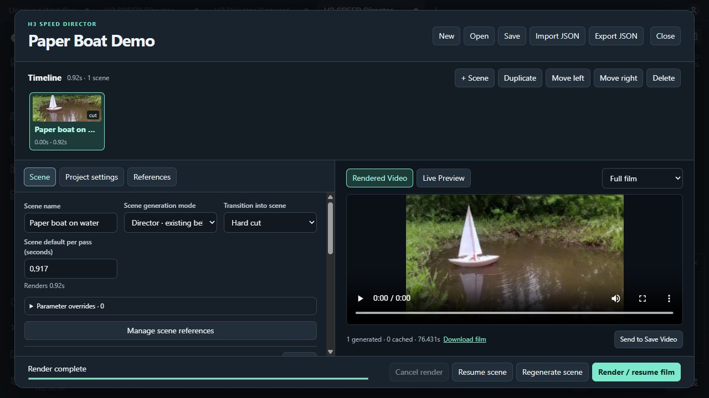

# MiniMax H3 SPEED Director

**A local film director for ComfyUI, built around the native MiniMax H3 SPEED sampler.**

[Install](docs/INSTALLATION.md) · [Direct your first film](docs/USER_GUIDE.md) · [Benchmarks](docs/BENCHMARKS.md) · [Troubleshooting](docs/TROUBLESHOOTING.md)

H3 SPEED Director puts a scene timeline, the Fantastic prompt builder, live sampling previews, render recovery and final export into one ComfyUI node. Build a shot, extend it, add the next scene, and assemble the film from the takes you already rendered. Each new pass runs the installed SPEED sampler with native H3 audio/video conditioning.

## Render incrementally

1. **Generate the first scene.** Preview the finished film, individual scene or segment in the Director.
2. **Append a scene or extend a take.** Completed passes with matching inputs are reused. An extension can start from the last frame of the previous pass.
3. **Change or regenerate one scene.** The Director reuses valid predecessors and reevaluates dependent shots on the next film render. Independent hard cuts can keep their existing checkpoints.
4. **Cancel and resume later.** Completed passes are committed to disk with audio and boundary frames. An interrupted pass starts over when resumed.
5. **Approve an export.** Select a finished film, scene or segment and click **Send to Save Video**. ComfyUI saves the selected file without running diffusion again.

Generation keys account for the model graph and model files, effective pass settings, seed, prompts, reference content, continuity inputs and explicit regeneration. Delivery has separate cache keys. Preview controls do not enter the generation keys. [See how checkpoints and continuity work](docs/ARCHITECTURE.md).

## What you can direct

| Area | Features |
| --- | --- |
| Generation | Native Automatic or Manual SPEED. Scene and pass prompts, duration and sampler overrides, extend and replace passes, and global character, environment and style descriptions. |
| Fantastic modes | **T2VA** for text, **I2VA** for a first image, **FL2VA** for first and last images, **L2VA** for a last image, and **REF** for ordered image, video and audio references. Mode-specific controls and H3 conditioning follow the selected pass. |
| Timeline | Drag to reorder, duplicate and delete scenes, choose hard cuts or continuity, inspect first-frame thumbnails, and play rendered video with synchronized audio. |
| Projects | Save and reopen local projects. Import or export JSON, optionally with the referenced media. Drop media into the References panel. |
| Delivery | Compose the final project canvas, set output FPS and export a synchronized MP4. Optional RIFE interpolation and NVIDIA RTX super resolution use installed dependencies. |

### Live sampling preview

Enable **Live Preview** before queueing a render. The monitor shows sampled frames and graphs for sigma and step time, then switches to the completed result. Max image edge, JPEG quality, frame count and playback FPS are adjustable. KJNodes and `taeh3.safetensors` provide the tiny CPU decoder for H3. Previews default to off. On the tested 16 GB system, enabling previews at the default settings averaged **138 s** per render versus **102 s** with previews off. Peak PyTorch sampling allocations matched, and sampled device-wide VRAM was roughly **200 MiB** higher. [Benchmark settings and all trials](docs/BENCHMARKS.md#live-preview).

## Get started

The tested baseline is **ComfyUI 0.43.0** with native MiniMax H3 support and the compatible [SPEED sampler](https://github.com/StanLukuvka/ComfyUI-SPEED-Sampler). Install [Fantastic](https://github.com/Adudeguyman/ComfyUI-Fantastic-MiniMaxH3-PromptBuilder) for the five structured modes. Bring a compatible MiniMax H3 audiovisual model, its text encoder and both VAEs. [Installation and model layout](docs/INSTALLATION.md).

1. Load the [Paper Boat workflow](workflows/H3%20SPEED%20Director%20-%20Paper%20Boat.json) in ComfyUI and select your installed models in its loaders.
2. Open **H3 SPEED Director → Open Director**. Set the scene and pass prompts and your checkpoint’s working SPEED preset.
3. Click **Render / resume film**. To continue the story, use **+ Scene** with **Continue previous shot**, or add an **Extend the shot** pass.

The optional [Paper Boat project JSON](examples/Paper%20Boat.h3director.json) is a media-free example for the Director’s **Import JSON** control. H3 samples on a 24 fps grid in segments of up to **362 frames (15.08 seconds)**. The final film can contain multiple segments. A reused frame anchors an edit, and motion, framing or audio can still change across the seam.

## Project information

[Architecture](docs/ARCHITECTURE.md) · [Validation and benchmarks](docs/BENCHMARKS.md) · [Changelog](CHANGELOG.md) · [License and upstream credits](THIRD_PARTY_NOTICES.md)

The Director’s source is [GPL-3.0-only](LICENSE). Models, third-party node packages and preview weights are installed separately under their own terms. The tested SPEED sampler uses PolyForm Noncommercial 1.0.0, and the MiniMax H3 model has a separate community agreement with geographic and usage restrictions. [SPEED license](https://github.com/StanLukuvka/ComfyUI-SPEED-Sampler/blob/main/LICENSE.md) · [MiniMax H3 agreement](https://huggingface.co/MiniMaxAI/MiniMax-H3/blob/main/LICENSE)
